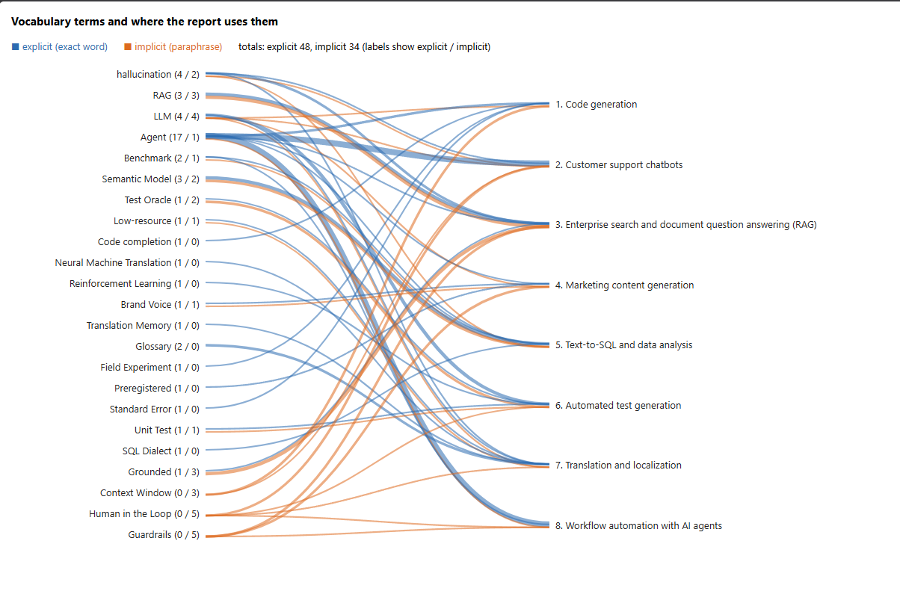

## Vocabulary usage graph

Blue lines are explicit usage (the exact term appears in the report section). 
Orange lines are implicit usage (the idea appears without the term). 
Line thickness shows frequency.     

## Agent-generated version

`02-agent-output/` was produced by a CodeMie assistant (default model) connected to this repo through the Git toolkit. It committed `report.md` and `vocabulary.md` on the branch `codemie-agent-output`, which I merged into `main`. The commits show my GitHub account because the agent used my access token.

My own files in this folder are separate and were not changed by the agent.

Differences I noticed:
- The agent picked its own 8 use cases and did not cover test generation, translation or code generation as a separate case.
- It cites no studies or figures.
- One of its links returned 404 (the Elastic AI Assistant page). I did not edit its output.
- It lists Amazon Q Developer, which AWS is retiring.